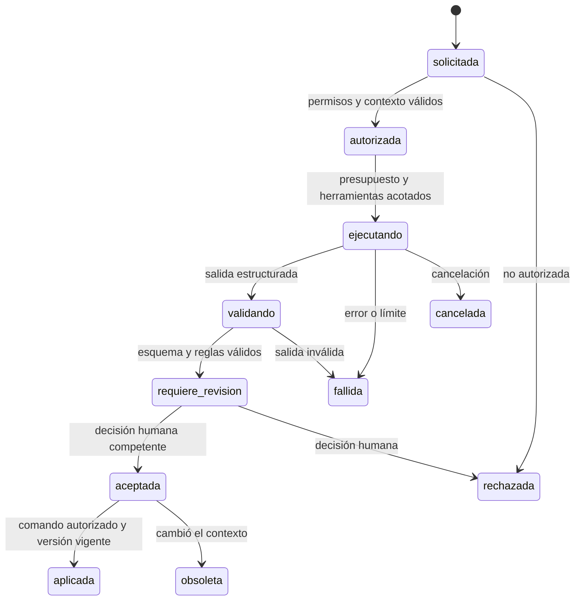

# Modelo de agentes

**Estado:** diseño propuesto para RQ-004 y RQ-005. No se implementan agentes ni se selecciona un framework, modelo o proveedor en esta entrega. Los roles de diseño no presuponen un proceso por rol.

## Catálogo de responsabilidades futuras

| Rol | Entradas autorizadas | Salida propuesta | Autoridad que no posee |
| --- | --- | --- | --- |
| Coordinador | Objetivo, permisos, estado de tarea y presupuesto. | Plan acotado y asignación de tareas. | Cambiar permisos, ampliar organización o aprobar resultados. |
| Estrategia y negocio | Objetivos y evidencia de la organización. | Capacidades, relaciones e inconsistencias sugeridas. | Inventar hechos del negocio. |
| Arquitectura empresarial | Catálogo y paquetes habilitados. | Vistas y análisis de dependencias o brechas. | Escribir hechos oficiales directamente. |
| Arquitectura de solución | Requisitos, restricciones y alternativas. | Diseños y compensaciones justificadas. | Aprobar una tecnología o desplegar. |
| Especialista sectorial | Conocimiento financiero curado y contexto del caso. | Recomendaciones y especializaciones propuestas. | Convertir una práctica en obligación jurídica. |
| Legal-regulatorio | Fuentes verificadas, versiones, fechas y hechos pertinentes. | Extracción, hipótesis de aplicabilidad, faltantes y citas. | Declarar cumplimiento, vigencia no verificada o aprobar su análisis. |
| Evaluación y gobierno | Propuesta, criterios y evidencia. | Hallazgos y comprobaciones de coherencia. | Sustituir al aprobador humano. |

## Ciclo de una tarea

La revisión y la aplicación son pasos separados. Una aceptación no evita comprobar otra vez permisos, organización, versiones y reglas en la transacción de aplicación. Un timeout o salida inválida nunca se convierte en éxito silencioso.

## Contrato lógico de ejecución

Cada tarea conservará `task_id`, organización, solicitante, propósito, rol del agente, referencias y revisiones de entrada, versiones de paquetes/fuentes, lista de herramientas y acciones permitidas, presupuesto, límite temporal y correlación. Cada intento añade versión del prompt/política, identificador y versión declarada del modelo, parámetros relevantes, herramientas utilizadas, resultado y errores.

La salida cumple un JSON Schema versionado y diferencia: afirmaciones con evidencia, inferencias, incertidumbre, contradicciones y comandos propuestos. Una puntuación del modelo no prueba verdad ni sustituye revisión. Conservar motivos resumidos y referencias útiles para auditoría, no solicitar ni almacenar razonamiento interno privado del modelo.

## Controles

- Herramientas mínimas por tarea y autorización en cada llamada. Sin ejecución arbitraria, SQL libre, acceso directo a base ni redes abiertas por defecto.
- Recuperación de contexto filtrada antes de enviarlo al modelo; no mezclar organizaciones en prompts, memoria, cachés o evaluaciones.
- Entradas documentales, páginas y resultados de herramientas tratados como datos no confiables. Su texto no redefine permisos ni políticas del sistema.
- No enviar secretos o datos sensibles a proveedores sin política y autorización; registrar retención y tratamiento conforme al piloto acordado.
- Límite de llamadas, tiempo y costo; cancelación y deduplicación por tarea. Reintentos solo de operaciones seguras y sin duplicar efectos.
- Citas deben resolver a evidencia autorizada y versión exacta. Texto sin evidencia permanece como hipótesis y no fundamenta conclusiones legales.
- Escrituras a través de comandos de dominio, con revisión esperada y auditoría; nunca aplicar un comando solo porque sea JSON válido.

## Evaluación antes de habilitar

Un primer caso asistido debe tener conjunto de casos sintéticos/permitidos, criterios de utilidad, errores conocidos, citas comprobables, resistencia a inyección, negativas de acceso y presupuesto. No usar aprobación de otro agente como equivalente a revisión humana. El desacuerdo entre agentes se registra, no se resuelve por votación automática.

En el trabajo documental actual un mismo asistente puede asumir las responsabilidades de análisis y revisión de forma secuencial, actualizando fuentes canónicas. Eso no instala ni valida el producto multiagente descrito aquí.
