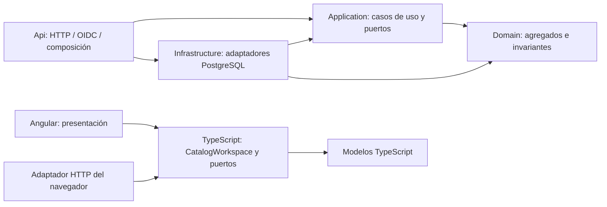

# Clean Architecture y arquitectura hexagonal de I1

**Estado:** decisión autorizada en [ADR-0015](../decisiones/0015-clean-architecture-hexagonal.md). Alcance: catálogo manual SPEC-CAT-001, mismo monolito modular, contratos y esquema de datos.

## Dependencias

Las flechas indican dependencias de código; en ejecución, un caso de uso llama un puerto y el contenedor entrega su adaptador. Api referencia Infrastructure únicamente para componerlo en Program.cs. Los adaptadores HTTP/OIDC dependen de Application/Domain, sin SQL o tipos del driver. No se crea un servicio desplegable por capa.

## Propiedad y puertos

| Módulo | Núcleo | Puerto de salida / adaptador |
| --- | --- | --- |
| Catálogo | ArchitectureEntity/Relationship, CatalogService, comandos y consultas tipados | ICatalogRepository / PostgresCatalog + PostgresPages |
| Auditoría del catálogo | AuditChange, AuditEvent; emisión obligatoria desde el caso de uso | IAuditPort / PostgresAudit, compartiendo transacción |
| Identidad/acceso | IdentityService, OrganizationAccess, políticas y membresías | IIdentityPort, IOrganizationTransaction / PostgresIdentity, DbSession |
| Presentación web | CatalogWorkspace y CatalogGateway, modelos TypeScript | HttpCatalogGateway; composición en main.ts/composition.ts |

Domain no conoce persistencia, web, organización activa global ni reloj de infraestructura. Los resultados de consulta no son los agregados de dominio; estos últimos concentran normalización, campos inmutables, estados, tipos y revisiones. Application expresa los casos de uso sin depender del protocolo; SQL, serialización y restricciones de base permanecen en el adaptador.

## Recorrido de escritura

1. OIDC/cookie identifica al sujeto; el adaptador HTTP obtiene el identificador interno validado.
2. OrganizationAccess consulta membresía en una transacción del sujeto y selecciona la organización después de autorizar rol/operación. PostgreSQL vuelve a exigir membresía activa y RLS en cada acceso.
3. HTTP valida antiforgery y forma JSON. Para modificar, se comprueba visibilidad antes de If-Match y antes del cuerpo, conservando 404 frente a recursos ajenos.
4. CatalogService carga agregados, valida y llama puertos específicos. Crear relación bloquea extremos en orden UUID; archivar entidad usa el mismo bloqueo y cuenta relaciones activas.
5. Persistencia y evento de auditoría comparten DbSession. Si cualquiera falla, no se confirma. Se comprueba el número de filas modificadas y revisión esperada.
6. El adaptador confirma al terminar y representa DTO con snake_case/ETag o error Problem Details. Dispose revierte las solicitudes fallidas.

Las consultas y páginas también reciben el contexto autorizado; no existe repositorio global de datos organizacionales. Las sesiones OIDC no aceptan roles de proveedor ni materializan membresías. Los datos del cliente nunca acreditan permiso.

## Entorno de desarrollo y límites

[Aip.slnx](../../Aip.slnx) expone proyectos y pruebas; [ejecución local](../delivery/ejecucion-local-i1.md) conserva las herramientas/versiones, HTTPS y servicios locales existentes. `scripts/check-architecture.py` verifica el grafo/importaciones; el build impide usar ASP.NET/Npgsql desde el núcleo. Las pruebas del núcleo funcionan sin servicios; la aceptación requiere PostgreSQL/Keycloak reales y exportación limpia.

Los scripts Python son herramientas/pruebas de desarrollo. No se implementan agentes ni se instalan frameworks adicionales. Los invariantes de organización se verifican en aplicación, adaptador y base; el cliente solo ofrece controles de conveniencia.
