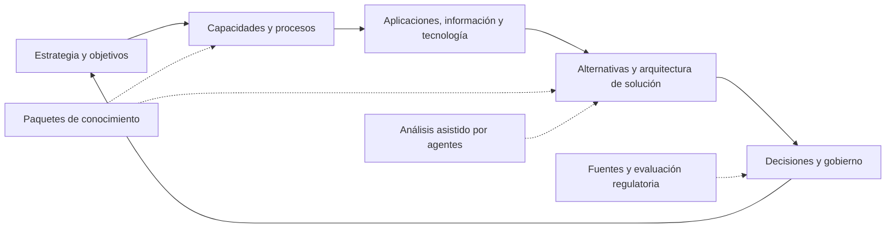

# Arquitectura funcional

**Estado:** propuesta para RQ-001–RQ-006; no describe capacidades ya implementadas.

## Cadena de valor

Las relaciones entre elementos permiten recorrer esa cadena; no se propone generar una arquitectura automáticamente sin validar sus entradas.

## Módulos lógicos y propiedad

| Módulo | Responsabilidad y datos propios | Dependencias permitidas | Etapa |
| --- | --- | --- | --- |
| Organización y acceso | Organización, membresía, contexto activo y autorización. | Proveedor de identidad mediante adaptador. | Prerrequisito de I1; administración completa diferida. |
| Catálogo arquitectónico | Entidades, relaciones, revisiones y reglas de integridad. | Contexto autorizado y definiciones de tipo. | I1. |
| Paquetes y metamodelo | Definiciones versionadas, dependencias y activación por organización. | Registro curado y contratos de Core. | Registro fijo en I1; motor instalable en I2. |
| Estrategia y vistas | Objetivos, capacidades, recorridos y vistas de arquitectura. | Catálogo mediante sus contratos. | Más allá del subconjunto de I1. |
| Gobierno y evidencia | Propuestas, revisiones, decisiones y evidencia versionada. | Referencias a recursos de otros módulos. | I3. |
| Conocimiento regulatorio | Fuentes, versiones, interpretaciones y evaluaciones de aplicabilidad. | Paquetes, evidencia y contexto organizacional. | I5. |
| Coordinación agéntica | Tareas, ejecuciones, presupuestos y propuestas de agentes. | Lecturas autorizadas y comandos validados; no acceso directo a tablas ajenas. | I4. |
| Auditoría | Eventos de cambio y consulta autorizada de su historia. | Identidad y contexto; escritura por operación controlada. | Transversal desde I1. |
| Integraciones y proyecciones | Importación/exportación futura y posibles índices de lectura. | Contratos públicos y eventos; nunca fuente alternativa de verdad. | Posterior según necesidad. |

Los módulos son límites internos de un backend modular candidato. No implican un microservicio o una base por módulo. Cada módulo conserva la propiedad de sus escrituras; no escribir tablas de otro módulo para evitar su validación.

## Recorridos

**I1 manual:** contexto de organización → consultar tipos permitidos → crear capacidad, aplicación y dato → crear relaciones → navegar → modificar con control de versión → consultar auditoría. Una relación no cambia el contenido de sus extremos.

**Futuro asistido:** solicitar análisis → autorizar contexto y herramientas → ejecutar tarea acotada → validar salida → revisar propuesta → aplicar comando de dominio autorizado → conservar evidencia. La propuesta no es una mutación automática.

**Futuro regulatorio:** verificar una fuente y versión → determinar hechos del caso → proponer aplicabilidad → revisión humana → vincular conclusión contextual → vigilar cambios e invalidar resultados dependientes cuando corresponda.

## Límites

El catálogo almacena hechos declarados y relaciones; no prueba por sí mismo cumplimiento ni corrección de una arquitectura. Un hallazgo, una recomendación y una decisión aceptada son objetos con autoridades y ciclos distintos. La taxonomía financiera no modifica reglas de integridad ni permisos del Core.
