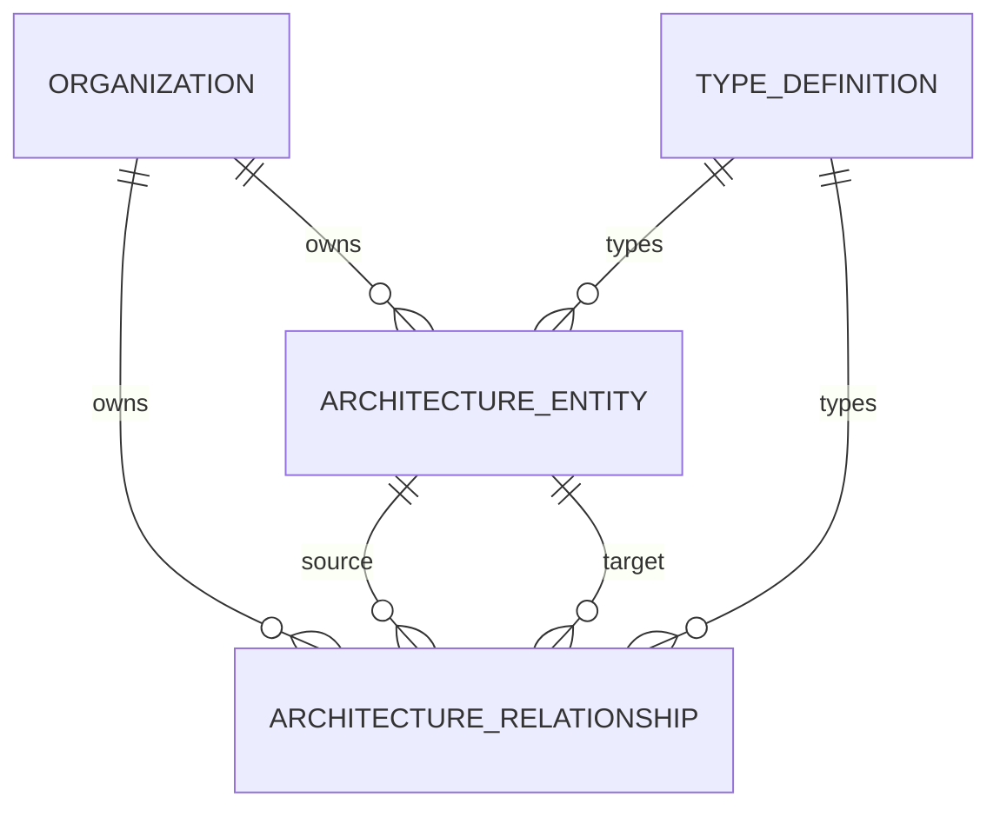

# Ontología preliminar

**Estado:** propuesta conceptual v0.1.0. No es una afirmación de equivalencia con un estándar ni una implementación de grafo. Core debe servir a más de una industria.

## Conceptos transversales

| Familia | Conceptos y significado | Presencia en I1 |
| --- | --- | --- |
| Límite de acceso | Organización y membresía: propietario y autorización del conocimiento privado. | Prerrequisito; no son entidades editables del catálogo. |
| Estrategia | Objetivo, iniciativa, resultado: intención y cambio buscado. | Diferida. |
| Negocio | Capacidad de negocio, proceso, flujo de valor, rol: qué puede hacer la organización y cómo. | Solo `core.business_capability`. |
| Solución | Aplicación, interfaz, componente tecnológico: sistemas y sus responsabilidades. | Solo `core.application`. |
| Información | Concepto de información y activo de datos: significado frente a recurso gestionado. | Solo `core.data_asset`; no contiene datos operativos. |
| Gobierno | Requisito, decisión, riesgo, control, evidencia, vista y revisión. | Auditoría técnica de catálogo; modelado completo diferido. |
| Conocimiento | Definición de tipo, paquete, versión y procedencia. | Registro fijo de los cinco tipos de I1. |
| Regulación | Fuente, versión de fuente, disposición, interpretación y evaluación de aplicabilidad. | Conceptos definidos en el modelo regulatorio; implementación diferida. |

Los objetos de gobierno/regulación tienen ciclos y evidencia propios; no deben reducirse automáticamente a un campo de texto o a una entidad genérica sin reglas. Un dato del catálogo es metadato de arquitectura, no una cuenta, cliente o transacción financiera.

## Entidades y relaciones de I1

| ID estable | Significado | Regla |
| --- | --- | --- |
| `core.business_capability` | Capacidad de negocio de una organización. | No implica que sea un proceso ni una función técnica. |
| `core.application` | Sistema de software identificado y gestionado. | No presupone despliegue o propiedad de su código. |
| `core.data_asset` | Activo de información descrito en la arquitectura. | Metadatos sintéticos en I1; sin contenido operativo. |
| `core.supports` | Una aplicación soporta una capacidad. | Dirección: application → business_capability. |
| `core.uses` | Una aplicación utiliza un activo de datos. | Dirección: application → data_asset. |

Las dos relaciones son muchos-a-muchos, sin autorrelaciones, con extremos activos y de la misma organización. No inferir la dirección inversa como un registro adicional. Cada tipo de relación especifica combinaciones de tipos origen/destino permitidas.

## Identidad y evolución

Entidad: UUID generado por servidor, organización, tipo y versión de esquema inmutables; código de negocio estable dentro de organización y tipo. Relación: identidad propia y extremos inmutables; no es una cadena sin validación. El namespace `core.*` está reservado; paquetes añaden tipos sin redefinirlo.

Separar cinco números: versión documental (`0.1.0`), versión de API (`v1` propuesta), versión de paquete, versión de esquema por tipo y revisión de cada registro. Que una aplicación cambie de nombre no cambia el significado del tipo ni la versión del paquete.

Las versiones de definiciones son inmutables. Las migraciones del metamodelo necesitan un mapeo explícito, validación, revisión de relaciones y tratamiento de registros incompatibles. I1 no implementa migración de esquemas ni tipos personalizados.

## Relaciones futuras, no habilitadas

`realizes` entre iniciativa y objetivo, `depends_on` entre elementos de solución y vínculos de evidencia a hallazgos son candidatos. Deben definirse tipos, semántica, cardinalidad y reglas antes de habilitarse. Una relación `complies_with` no probaría cumplimiento por su mera existencia; la conclusión requiere evaluación y evidencia versionadas.
