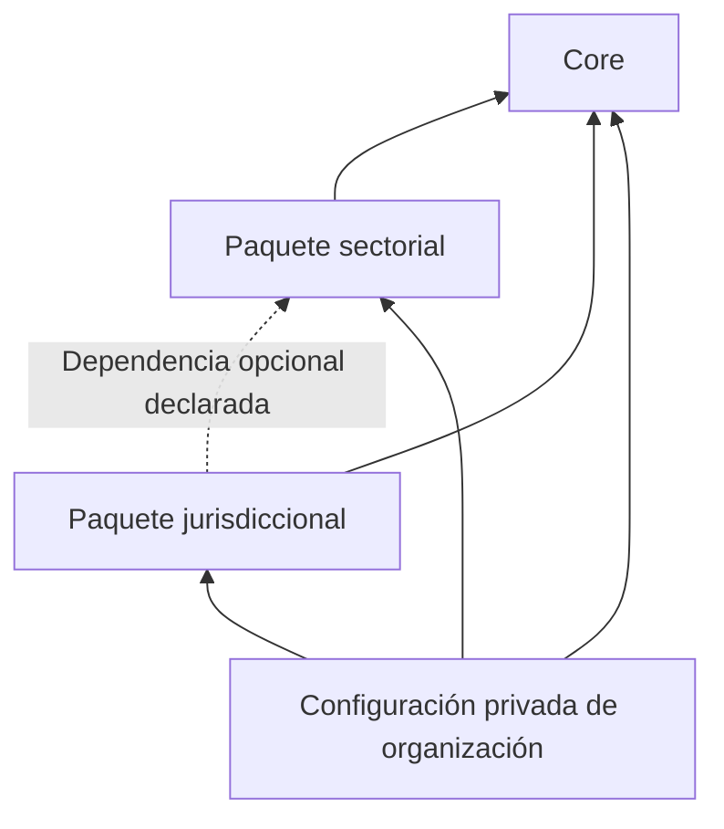

# Core y paquetes de conocimiento

**Estado:** propuesta; RQ-003 exige la separación, no aprueba aún el mecanismo de instalación. ADR-0011 recoge el diseño candidato.

## Fronteras

| Capa | Contiene | No contiene |
| --- | --- | --- |
| Core | Conceptos transversales, integridad, acceso, contratos, evidencia, gobierno y mecanismos de extensión. | Taxonomía exclusiva de un sector, leyes de un país, contenido privado de clientes. |
| Paquete sectorial | Vocabulario, especializaciones, patrones y criterios de referencia de una industria. | Afirmaciones universales de obligación legal o datos de organizaciones. |
| Paquete jurisdiccional | Fuentes y versiones verificadas, ámbito territorial/material/temporal y conocimiento legal contextualizado. | Conclusión automática de aplicabilidad para toda organización. |
| Configuración de organización | Paquetes habilitados, extensiones privadas, arquitectura propia, hechos y aprobaciones. | Modificación global del Core o de paquetes usados por otras organizaciones. |

Las flechas representan dependencia. Core no conoce paquetes concretos. Un paquete jurisdiccional puede ser transversal o especializar un sector; declarar la dependencia exacta en lugar de duplicar conocimiento.

## Contrato de paquete propuesto

Un manifiesto declarativo futuro debe incluir: `package_id`, nombre, tipo (`sector` o `jurisdiction`), editor, versión, compatibilidad con Core, dependencias, namespaces, definiciones de entidades/relaciones, esquemas, procedencia, licencia/derechos de uso y hash de integridad. Los paquetes jurisdiccionales añaden jurisdicción, materia, cobertura declarada y estado de verificación de fuentes.

La firma o el canal de distribución y su modelo de confianza están pendientes antes de habilitar instalación. Un hash detecta cambios, no acredita por sí mismo un editor confiable. No ejecutar código o prompts con privilegios por instalar un paquete.

## Reglas de composición

1. IDs y versiones de paquete son inmutables. Usar versionado semántico y resolver dependencias a versiones exactas en cada activación organizacional.
2. Namespaces ilustrativos: `core.*`, `sector.finance.*`, `jurisdiction.<code>.*`, `org.<id>.*`. Los ejemplos jurisdiccionales no identifican un país seleccionado.
3. Extender con tipos o perfiles nuevos; no sustituir reglas de integridad, permisos o tipos `core.*` por precedencia silenciosa.
4. Verificar dependencias, ausencia de ciclos y compatibilidad antes de activar. Un conflicto falla con explicación; no elegir automáticamente la última versión.
5. Las definiciones públicas curadas son compartibles y de solo lectura. Datos, extensiones y evaluaciones privadas se resuelven dentro de la organización autorizada.
6. La resolución de tipos usa las versiones habilitadas de la organización. Una actualización global no migra sus registros ni aprueba sus evaluaciones.
7. Desactivar un paquete referenciado no borra ni deja ilegibles datos existentes. Bloquear nuevas creaciones y conservar la definición histórica; exigir plan de migración para retirarlo.
8. Cambios en fuentes jurídicas pueden requerir invalidar evaluaciones, aunque la estructura técnica del paquete siga siendo compatible.

## Alcance incremental

I1 lleva un registro fijo `core.catalog` v0.1.0 con tres tipos de entidad y dos de relación, definido con la aplicación cuando se autorice. No incluye instalador, repositorio remoto de paquetes, resolución dinámica, editor de esquemas ni extensiones privadas. I2 implementaría el mecanismo, con pruebas de compatibilidad y aislamiento.

Contenido financiero inicial y fuentes por jurisdicción requieren validación de dominio, verificación normativa y derechos de redistribución antes de comercialización.
