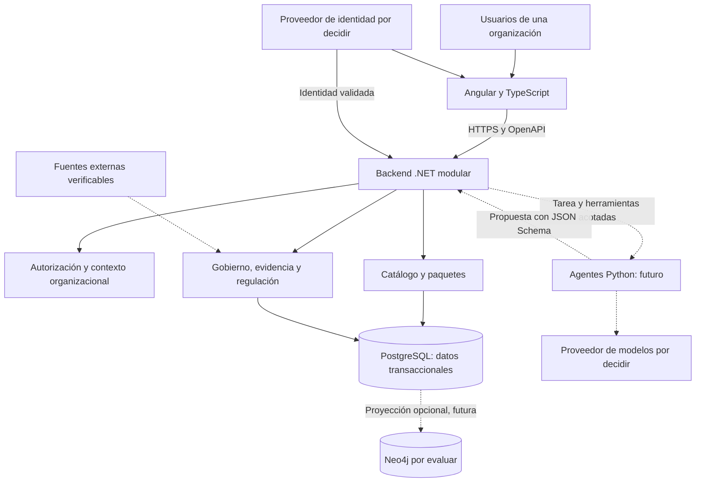

# Arquitectura de referencia

**Estado:** propuesta. Dirección tecnológica del usuario, detallada en ADR-0002–ADR-0011. Ningún componente está instalado o implementado por estos documentos.

## Contexto y componentes lógicos

El diagrama es lógico: no fija topología de despliegue, colas, contenedores ni infraestructura. Los accesos a datos pasan por autorización; la posición visual de un módulo no exime de ese control.

## Propuesta base

- **Angular/TypeScript:** experiencia web y validación de conveniencia. Nunca autoridad de permisos o validación de dominio.
- **.NET modular:** autenticación, autorización, comandos, consultas y reglas de negocio. Un único backend inicial reduce coordinación distribuida; extraer servicios solo por evidencia.
- **PostgreSQL:** fuente de verdad para catálogo, pertenencia, revisiones y auditoría. Transacciones para integridad y eventos de cambio. Separación lógica por módulo y organización; estrategia física propuesta en ADR-0010.
- **Python:** ejecución futura de capacidades de IA detrás de contratos. No necesario para el catálogo; no tiene credenciales de escritura directa a los datos transaccionales.
- **OpenAPI y JSON Schema:** contrato HTTP y estructuras de tipos/propuestas respectivamente; versiones explícitas y pruebas de compatibilidad futuras.
- **Neo4j:** candidato para consultas de recorrido e impacto, únicamente si una evaluación demuestra valor. No participa en I1 ni sustituye a PostgreSQL.

## Límites internos propuestos

En cada módulo .NET, separar dominio, casos de uso, adaptadores de persistencia/integración y presentación HTTP sin exigir proyectos o capas vacías. Los contratos entre módulos son explícitos; una consulta externa no concede escritura sobre el dominio consultado. No introducir un bus distribuido, CQRS complejo o eventos como fuente de verdad sin necesidad demostrada.

I1 puede resolver relaciones con PostgreSQL. Si se incorpora un grafo después, definir eventos transaccionales/outbox, orden por revisión, borrados, reconstrucción, retraso observado y filtrado de organización. No hacer escrituras dobles independientes. Cualquier resultado obsoleto o sin contexto autorizado debe descartarse; PostgreSQL conserva autoridad.

## Consistencia y evolución

- Revisión del recurso para concurrencia optimista; no confundirla con versión de esquema.
- Identificadores de tipos con namespace y versión de definición inmóvil para cada registro.
- Operaciones y auditoría de mutaciones dentro de la misma transacción en I1.
- Cambios de contrato compatibles dentro de una versión; cambios incompatibles requieren nueva versión y estrategia de transición.
- No asumir que el esquema de OpenAPI y el de JSON Schema son intercambiables sin validar dialecto y herramientas. Se propone OpenAPI 3.1 y JSON Schema 2020-12, pendientes de ADR-0008.

## Atributos por validar

Aislamiento y trazabilidad son condiciones desde I1. Disponibilidad, volumen, latencia, costos, retención, recuperación y residencia requieren datos del piloto. Usar mediciones y amenazas reales antes de elegir escalamiento o despliegue. No se ofrece una garantía productiva desde un prototipo local.

La organización de carpetas de aplicación se decidirá al aprobar I1; esta entrega no crea esqueletos ni instalaciones.
