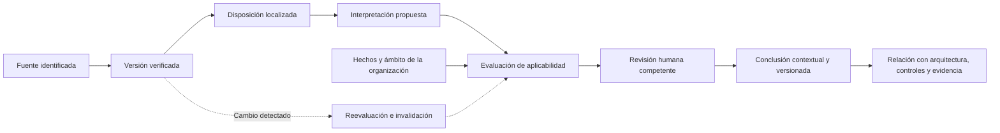

# Modelo legal-regulatorio

**Estado:** propuesta de diseño para RQ-005. No se ha seleccionado jurisdicción ni consultado/verificado una fuente normativa en esta entrega. Este documento no atribuye obligaciones jurídicas ni certifica cumplimiento.

## Cadena de trazabilidad

## Objetos y evidencia requerida

| Objeto | Contenido mínimo |
| --- | --- |
| `RegulatorySource` | Autoridad identificada, identificador oficial, título, jurisdicción y ubicación oficial. Estado de verificación explícito. |
| `SourceVersion` | Documento y localización verificables, fecha de publicación si consta, captura/consulta, hash del contenido, método y revisor de verificación, versión y derechos de uso. Un hash no acredita autoridad. |
| `Provision` | Localizador exacto dentro de una versión, fragmento verificable y contexto necesario; no inventar numeración ausente. |
| `Interpretation` | Enunciado interpretado, disposiciones que lo sustentan, inferencias, dudas y autor humano o agente. No es texto normativo original. |
| `ApplicabilityAssessment` | Organización, actividad/producto/entidad jurídica pertinente, territorio, hechos y revisiones, fecha evaluada, criterios, evidencia y resultado propuesto. |
| `HumanReview` | Persona, rol/competencia, ámbito, decisión, motivos, fecha y versiones exactas de fuente, interpretación y evaluación revisadas. |
| `RegulatoryFinding` | Resultado contextual, límites e incertidumbre, referencias a control/arquitectura/evidencia y revisión. No usarlo como certificación general. |

Fuentes y definiciones públicas pueden formar un paquete curado; hechos organizacionales, evaluaciones, hallazgos y revisiones son privados de su organización. La curación de una fuente no aprueba su aplicabilidad a ningún cliente.

## Temporalidad y vigencia

Separar **tiempo del hecho jurídico** de **tiempo de conocimiento del sistema**. Registrar fecha de publicación, inicio y fin de efecto si constan, disposiciones transitorias, modificaciones o derogaciones verificadas, fecha de observación y última verificación. Conservar la historia; no sobrescribir una fuente porque exista una más reciente.

Estados de fuente propuestos: `unverified`, `verified`, `verification_required`. Estado temporal de una disposición: `unknown`, `future`, `in_effect`, `partially_in_effect` o `ceased`, siempre según fecha de referencia y evidencia. No equiparar «descargada», «publicada» o «verificada» con «vigente y aplicable».

Un error de consulta o una fecha ausente produce incertidumbre. Política de actualización, frecuencia de comprobación y umbral de antigüedad se definirán por materia y fuente; no se inventa una frecuencia legal. Al superar el umbral acordado, bloquear el uso de la evaluación como conclusión vigente hasta revisión.

## Aplicabilidad y revisión

Resultados posibles: `undetermined`, `applicable`, `not_applicable`, `partially_applicable`. Cada resultado necesita hechos, criterio, evidencia y ámbito. **Falta de evidencia = undetermined**, nunca `not_applicable` ni cumplimiento. «Aplicable» tampoco significa «cumplido»; evaluar cumplimiento requeriría alcance, pruebas y responsables adicionales.

El agente prepara una evaluación; un especialista humano autorizado verifica citas, interpretación, contexto, vigencia y límites y puede aprobarla, rechazarla o solicitar información. La interfaz debe mostrar que está pendiente hasta esa revisión. El estado editorial de aprobación es independiente del resultado de aplicabilidad.

La revisión enlaza versiones exactas y fecha evaluada, y no se reutiliza para otro cliente, jurisdicción, producto o periodo por similitud textual. Cambios relevantes de norma, interpretación, hechos, evidencia o paquete marcan la evaluación `requires_reassessment` y bloquean su uso como conclusión actual; conservar lo aprobado como historia.

## Conflictos y fuentes no verificables

- Contradicciones entre fuentes, jerarquía, traducciones, ámbitos o disposiciones se elevan a revisión; no aplicar una regla genérica de precedencia inventada.
- Una fuente secundaria puede orientar búsqueda y quedar etiquetada; no se presenta como fuente oficial ni sustituye la verificación necesaria.
- Si la fuente oficial no está disponible, registrar la limitación y mantener el estado no verificado; no completar referencias con contenido generado.
- No incorporar material sin revisar permisos de consulta, conservación y redistribución comercial.

## Condición para una entrega regulatoria

Elegir subsegmento, jurisdicción y materia; verificar un corpus pequeño con evidencia; definir revisores competentes y política de actualización; ejecutar casos de aplicabilidad positiva, negativa, parcial y desconocida. Probar cambios de vigencia, hechos y fuente, invalidación de aprobación, citas inexistentes, inyección y separación de organizaciones. Todo queda fuera de I1.
